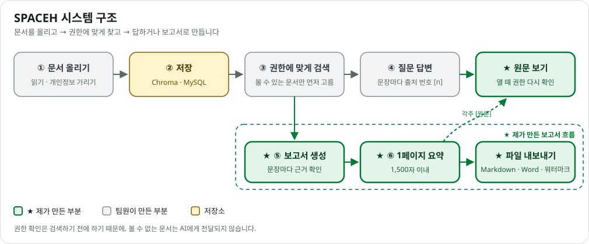

<div align="center">

# SPACEH

**여러 계열사 문서를 권한에 맞게 검색하고, 출처와 함께 답하고, 보고서로 만들어 주는 AI 서비스 (RAG)**

현대경제연구원 · 현대무벡스 · 현대엘리베이터


현대 AI 서비스 개발자 부트캠프 · 프로젝트 1 · TEAM SPACEH

**박예원 · 보고서 생성 · 1페이지 요약 · 원문 보기 · 파일 내보내기 담당**

</div>

---

## 한눈에 보기

| 항목 | 내용 |
| --- | --- |
| 기간 | 2026.10 ~ 2026.11 |
| 인원 | 7명 (제 파트: 답변 · 보고서) |
| 내 역할 | AI 보고서 생성과 근거 검증, 1페이지 요약, 출처 원문 보기, 보고서 저장 · 파일 내보내기 |
| 내 기여 | 기능 4개 · PR 6개 머지 · 커밋 16개 · 테스트 117개 작성 |
| 원본 저장소 | [TEAM-SPACEH/spaceh](https://github.com/TEAM-SPACEH/spaceh) |

> 이 README는 팀 프로젝트를 제 담당 부분 중심으로 정리했습니다. 제가 만든 부분은 **★**로 표시했습니다.

## 개발 배경

| 문제 | SPACEH의 해결 |
| --- | --- |
| 계열사마다 문서가 흩어져 있음 | 세 회사 문서를 **한 번에 검색**하고, 출처를 회사별로 보여 줌 |
| 공개 문서와 기밀 문서가 섞여 있음 | 볼 수 있는 문서만 **검색하기 전에** 골라냄. 볼 수 없는 문서는 AI에게도 넘기지 않음 |
| AI가 그럴듯하게 지어낸 답을 함 | 문장마다 **출처 번호 [n]**을 붙이고, 코드로 한 번 더 확인한 내용만 보여 줌 |

## 주요 기능

**검색 · 질문 답변**
- 키워드 검색과 의미 검색을 합친 통합 검색
- 회사 · 문서 종류 · 기간 필터, 권한에 맞는 문서만 검색
- 출처 번호가 붙은 AI 답변, **★ 출처를 누르면 원문 페이지 보기**

**보고서 ★**
- ★ 주제만 고르면 세 회사 문서로 **개요 · 현황 · 시너지 · 제언** 보고서를 AI가 작성
- ★ 문장마다 출처가 맞는지 확인, 틀린 문장은 다시 쓰게 하거나 빼기
- ★ 바쁜 사람을 위한 **1페이지 요약**, 요약에서 자세한 내용으로 바로 이동
- ★ **Markdown · Word 파일**로 내려받기 (받은 사람 표시), 보고서 저장 · 다시 열기

**문서 올리기**
- PDF · Word · PowerPoint 읽기, 이미지 속 글자 인식(OCR)
- 연락처 · 이메일 · 계좌번호를 자동으로 가린 뒤 검색할 수 있게 저장

**권한 · 관리**
- 역할 3단계(사원 · 계열사 관리자 · 최종 관리자) × 보안 등급 3단계(공개 · 내부 · 기밀)
- 다른 회사와 문서 공유, 열람 권한 요청과 승인
- 누가 무엇을 봤는지 남기는 감사 로그

---

## ★ 제가 맡은 부분

### 1. AI가 지어낸 문장 걸러 내기 — 보고서 생성 (R-02)

| | |
| --- | --- |
| **문제** | AI는 근거 문서에 없는 내용이나 숫자를 그럴듯하게 지어낼 수 있습니다. 보고서에 틀린 매출 숫자가 들어가면 잘못된 판단으로 이어집니다. |
| **해결** | AI가 쓴 글을 **문장마다** 코드로 검사했습니다. ① 출처 번호가 있는지 ② 문장 속 숫자가 원래 문서에 정말 있는지 ③ "시너지"라면 두 회사 이상의 자료를 썼는지 확인합니다. 틀리면 **한 번 다시 쓰게** 하고, 그래도 틀리면 **그 문장만 뺍니다.** |
| **결과** | 근거가 확인된 문장만 보고서에 남습니다. 근거가 없는 부분은 지어내지 않고 "근거 자료 없음"으로 알려 줍니다. |

### 2. 긴 보고서를 한 장으로 — 1페이지 요약 (R-04)

| | |
| --- | --- |
| **문제** | 보고서가 A4 2~3장이라 바쁜 임원은 다 읽기 어렵습니다. 그런데 AI에게 "줄여 줘"라고 하면 줄이다가 숫자를 바꾸기도 합니다. |
| **해결** | 핵심 내용 · 계열사별 시사점 · 권고안을 **1,500자 이내**로 요약하고, 같은 문장 검사를 다시 거칩니다. 줄인 글에 **원래 없던 숫자나 출처 번호가 생기면 받지 않습니다.** |
| **결과** | 한 장 요약에서 [상세 보기]를 누르면 상세보고서의 해당 부분으로 바로 이동합니다. |

### 3. 문서가 새지 않게 — 원문 보기 · 저장 · 파일 내보내기 (S-05 · R-05)

| | |
| --- | --- |
| **문제** | 검색할 때는 볼 수 있던 문서라도, 원문을 여는 사이에 권한이 바뀔 수 있습니다. 파일은 회사 밖으로 나갈 수도 있습니다. |
| **해결** | 원문을 **여는 순간**, 파일을 **받는 순간** 권한을 다시 확인합니다. 권한이 없으면 제목만 보여 줍니다. 업로드 폴더 밖의 파일은 열지 않고, 파일에는 **받은 사람 · 날짜**를 새깁니다. 열람과 다운로드는 감사 로그에 남깁니다. |
| **결과** | 보고서를 저장했다가 똑같이 다시 열 수 있고, Word 파일 안에서도 요약 → 상세 섹션으로 이동하는 링크가 동작합니다. |

### 트러블슈팅

**감사 로그가 3번씩 쌓이던 문제**
- **현상**: 원문을 한 번 열었는데 열람 기록이 3건 남았습니다.
- **원인**: Streamlit은 버튼을 누를 때마다 화면 코드를 처음부터 다시 실행합니다. 그때마다 기록이 남았습니다.
- **해결**: "이미 기록한 문서"를 세션에 표시해 두고, **처음 열 때만** 기록하도록 바꿨습니다.
- **결과**: 3건 → 1건. 자동 테스트를 추가해 같은 문제가 다시 생기지 않게 했습니다.

**머지된 브랜치에 올린 코드가 빠진 문제**
- **현상**: 이미 합쳐진(merge) 브랜치에 수정을 올렸더니 팀 코드(develop)에 들어가지 않았고, 그 코드를 쓰던 다른 PR이 오류로 깨졌습니다.
- **해결**: 빠진 커밋을 다시 합치고, 이후에는 **새 이슈 · 새 브랜치나 아직 열린 PR**로만 올렸습니다.
- **배운 점**: Git 브랜치와 PR의 흐름, 팀 협업 규칙이 왜 필요한지 알게 됐습니다.

### 사용한 기술

| 기술 | 어디에 썼나 |
| --- | --- |
| LangChain · OpenAI | 섹션별 보고서 작성, 1페이지 요약 |
| 정규식 (`re`) | 문장에서 출처 번호 `[n]`과 숫자 찾기 |
| python-docx | Word 파일 만들기, 페이지 나누기, 문서 안 링크 |
| MySQL · JSON | 보고서 저장과 그대로 다시 불러오기 |
| unittest · mock | 진짜 AI · DB 없이 테스트 (가짜 AI · 가짜 DB 사용) |

**제가 올린 PR** · [#54 원문 보기](https://github.com/TEAM-SPACEH/spaceh/pull/54) · [#90 보고서 생성](https://github.com/TEAM-SPACEH/spaceh/pull/90) · [#105 1페이지 요약](https://github.com/TEAM-SPACEH/spaceh/pull/105) · [#109 열람 기록](https://github.com/TEAM-SPACEH/spaceh/pull/109) · [#114 보고서 저장](https://github.com/TEAM-SPACEH/spaceh/pull/114) · [#115 파일 내보내기](https://github.com/TEAM-SPACEH/spaceh/pull/115)

---

## 화면

| 통합 검색 · 근거 답변 | ★ 원문 보기 |
| :---: | :---: |
|  |  |
| 출처 번호가 달린 답변과 회사별 출처 | 답변이 가져온 문단을 원문에서 형광펜으로 표시 |
| **★ 보고서 · 1페이지 요약** | **로그인** |
|  |  |
| 세 회사 문서로 만든 보고서와 출처 목록, 파일 내려받기 | 사원번호로 로그인, 역할과 소속에 맞는 문서만 보임 |

## 시스템 구조



> **초록(★)이 제가 만든 부분**입니다. 검색된 문서로 ④ 질문에 답하거나, ⑤ 보고서를 만들고 → ⑥ 한 장으로 요약한 뒤 → 파일로 내보냅니다. 출처 번호를 누르면 원문을 볼 수 있고, 원문을 여는 순간에도 권한을 다시 확인합니다.

### 권한 규칙

| 역할 \ 문서 | 공개 | 자사 내부 | 타사 내부 (공유 OFF) | 타사 내부 (공유 ON) | 자사 기밀 | 타사 기밀 |
| --- | :-: | :-: | :-: | :-: | :-: | :-: |
| 일반 사원 | ✅ | ✅ | 승인 시 | ✅ | 승인 시 | 승인 시 |
| 계열사 관리자 | ✅ | ✅ | 승인 시 | ✅ | ✅ | 승인 시 |
| 최종 관리자 | ✅ | ✅ | ✅ | ✅ | ✅ | ✅ |

- 다른 회사 문서는 **공유**(내부 문서만)되거나 그 회사 관리자가 **열람을 승인**해야 볼 수 있습니다.
- 기밀 문서는 공유할 수 없고, 원문 보기 · 다운로드 · 보고서 파일처럼 문서가 밖으로 나가는 곳마다 권한을 다시 확인합니다.

## 설계 원칙

- **권한은 검색하기 전에 확인합니다.** 검색한 뒤에 거르지 않고, 처음부터 볼 수 있는 문서 안에서만 찾습니다.
- **AI가 만든 결과는 코드로 다시 확인합니다.** 출처 번호와 숫자를 검사하고, 틀리면 다시 쓰기 → 문장 빼기 → 포기 순서로 처리합니다.
- **애매하면 막습니다.** 로그인이나 역할 정보가 이상하면 아무것도 보여 주지 않습니다.
- **역할을 나눠 코드를 씁니다.** 화면(`views`) → 처리(`services`) → DB(`repositories`) 순서로 부르고, 화면에서는 판단하지 않습니다. DB 쿼리는 안전한 방식(`%s`)으로만 씁니다.

## 빠른 시작

**준비물**: Python 3.11, MySQL 8.0.16 이상, OpenAI API 키

```bash
# 1. 가상환경과 패키지
python3.11 -m venv .venv && source .venv/bin/activate   # Windows: py -3.11 -m venv .venv; .venv\Scripts\Activate.ps1
pip install -r requirements.txt

# 2. 환경 변수 (API 키, DB 접속 정보, 시드 비밀번호)
cp .env.example .env                                     # Windows: copy

# 3. DB · 테이블 · 계열사 · 시드 계정
mysql -u root -p -e "CREATE DATABASE IF NOT EXISTS spaceh CHARACTER SET utf8mb4 COLLATE utf8mb4_0900_ai_ci"
mysql -u root -p spaceh < db/schema.sql                  # 주의: 기존 테이블 삭제 후 다시 만듦
mysql -u root -p spaceh < db/seed.sql
python -m scripts.seed_users

# 4. OCR 모델 (처음 한 번, 인터넷 필요)
python -m scripts.prepare_ocr

# 5. 실행 → http://localhost:8501
streamlit run main.py
```

시드 계정은 `ADM-0001`(최종 관리자), 사원 `HRI-0001` · `MVX-0001` · `ELV-0001`, 계열사 관리자 `HRI-0002` · `MVX-0002` · `ELV-0002`이고, 비밀번호는 `.env`의 `SEED_DEFAULT_PASSWORD`입니다. 자세한 설치 방법은 [로컬 개발 환경](docs/workflows/local-development.md)에 있습니다.

## 프로젝트 구조

```text
spaceh/
├── main.py              # 프로그램 시작 · 화면 이동
├── core/                # 설정 · DB 연결 · 보안 · 상수
├── app/
│   ├── auth/            # 로그인
│   ├── users/           # 내 정보
│   ├── permissions/     # 권한 확인 · 열람 요청
│   ├── search/          # 검색 · AI 답변 · 후속 질문
│   ├── documents/       # ★ 출처 · 원문 보기
│   ├── ingestion/       # 문서 읽기 · 개인정보 가리기 · 검색용 저장
│   ├── admin/           # 업로드 · 문서 관리 · 공유 · 감사 로그 · 승인
│   ├── reports/         # ★ 보고서 생성 · 1페이지 요약 · 저장 · 내보내기 (근거 수집·각주·다운로드 통제는 팀원)
│   ├── history/         # 내 사용 기록
│   └── common/          # 공통 화면 요소
├── db/                  # 테이블 · 기본 데이터
├── tests/               # 자동 테스트
└── docs/                # 설계 · 규칙 · 결정 기록
```

## 기술 스택

| 영역 | 기술 |
| --- | --- |
| 화면 | Streamlit |
| AI | OpenAI `gpt-4o-mini` (글 쓰기 · 판단), `text-embedding-3-small` (의미 검색), LangChain |
| 검색 | Chroma (의미 검색), rank-bm25 (키워드 검색), RRF (두 결과 합치기) |
| 문서 처리 | pdfplumber, python-docx, python-pptx, EasyOCR |
| 데이터 | MySQL 8, PyMySQL |
| 테스트 | unittest |

## 팀원

| 이름 | GitHub | 역할 | 맡은 영역 |
| --- | --- | --- | --- |
| 이현종 | [@Navi-Up](https://github.com/Navi-Up) | 팀장 | DB · 설정 · 통합 · 테스트 |
| 이서현 | [@SeoHyun1024](https://github.com/SeoHyun1024) | 검색 · 계정 | 통합 검색, 권한 필터, 하이브리드 검색, 사용 기록 |
| 이상훈 | [@sh5316](https://github.com/sh5316) | 검색 · 계정 | 검색 필터, 후속 질문, 로그인, 내 정보, 권한 요청 |
| 정재연 | [@jaeyeonjeong62](https://github.com/jaeyeonjeong62) | 문서 · 관리자 | 파일 로더, 청킹 · 색인, 업로드, 권한 승인 |
| 이승준 | [@s-zuni](https://github.com/s-zuni) | 문서 · 관리자 | 마스킹, 문서 관리, 공유, 감사 로그, 다운로드 통제, 계열사 추가 |
| 김소은 | [@soeundipia-teez](https://github.com/soeundipia-teez) | 답변 · 보고서 | 근거 답변, 보고서 근거 수집, 각주 |
| **박예원** | [@yewon-studio](https://github.com/yewon-studio) | **답변 · 보고서** | **원문 보기, 보고서 생성, 1페이지 요약, 저장 · 내보내기** |

## 개발 문서 · 협업

- [보고서 설계](docs/architecture/report.md) · 보고서를 어떤 기준으로 만들고 검사하는지 (제가 팀과 정한 기준)
- [구조 개요](docs/architecture/overview.md) · [결정 기록](docs/decisions.md) · [코드 규칙](docs/conventions/coding.md) · [Git 규칙](docs/conventions/git.md)
- 이슈 → 브랜치 → PR → 리뷰 승인 → 팀장 머지 순서로 협업했습니다.
